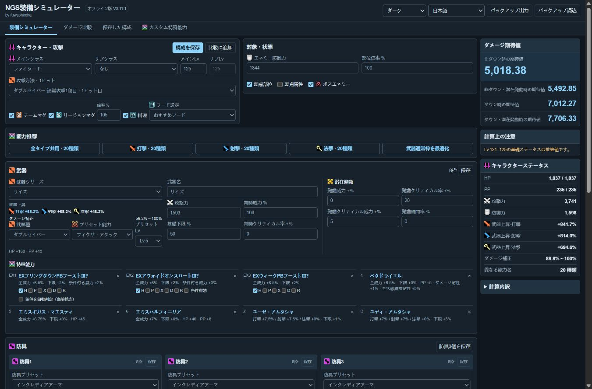

# NGS 装備シミュレーター

日本語 | [简体中文](README_CN.md)

PSO2 NGSの装備構成と、1ヒットのダメージ期待値を比較するオフラインツールです。

## 主な機能

- 武器、防具3個、リング、ネックレス、特殊能力を編集。
- メイン／サブクラスのレベル、敵・攻撃条件、フード、マグを設定。
- 特殊能力の一括設定、武器の通常能力枠の最適化、カスタム能力。
- ダメージ比較、構成保存、JSONの書き出し・読み込み。
- コンパクト表示、日本語・中国語、システム連動／ライト／ダーク配色。

## 使い方

`index.html` をダウンロードしてブラウザーで開くだけで利用できます。インストールは不要です。

クラスと攻撃条件を選び、装備を調整すると計算結果が更新されます。データはブラウザーに保存されます。別の端末へ移すときは「エクスポート」を使ってください。

1ヒットの計算ツールです。攻撃ループのDPSや独立追撃は自動計算に含みません。

## データと画像

[PSO2 NGS 攻略 Wiki](https://pso2ngs.swiki.jp/) を参照しています。出典は [アイコン出典](图标来源.txt)、[/MNSデータ](MNS数据来源.txt) を参照してください。画像はHTMLに含まれています。

非公式ツールです。ゲーム内容・画像 © SEGA。
